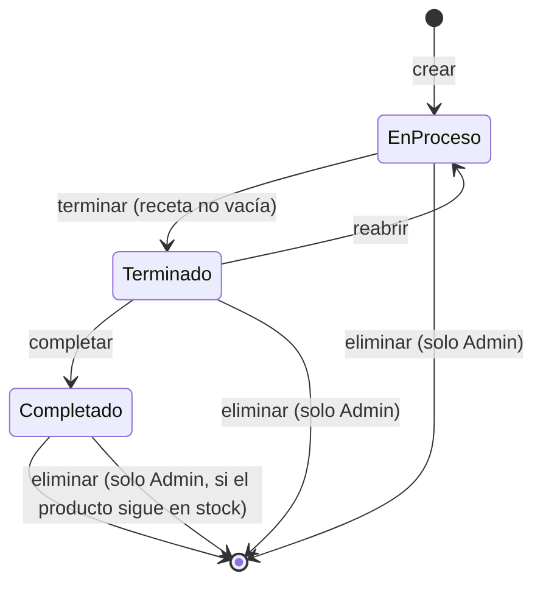

# Ensambles: cómo funcionan por dentro

**Para quién es esto:** el equipo que va a construir el inventario de un gastrobar
(cocteles, preparaciones, insumos de barra) y quiere copiar o adaptar el módulo de
Ensambles de la app de Compresores del Valle.

**De dónde sale:** todo lo que dice este documento se verificó contra el código y
las migraciones de la base de datos del repositorio (estado al 2026-10-04). Donde
algo existe pero no se usa, o se usa de una forma que conviene no copiar, se dice.

---

## 1. El contexto del negocio

Compresores del Valle vende repuestos neumáticos y compresores, y tiene un taller.
Muchos de los compresores que vende **los arma ella misma**: toma un motor, un
tanque, un cabezote, una base, unos acoples, y los junta en un equipo nuevo que
después se vende como un solo producto.

Ese "armar" es un **ensamble**: unos productos del inventario se gastan y aparece
otro producto nuevo en el inventario.

```
  motor  ─┐
  tanque ─┼──►  ENSAMBLE  ──►  1 compresor de 2 HP (listo para vender)
  cabezote┘
```

El problema que resuelve es el mismo que tiene un bar: **el mismo producto se
puede vender solo, o se puede gastar como parte de otra cosa.** Un motor se vende
en el mostrador, pero también se usa para armar un compresor. Una botella de ron
se vende cerrada, pero también se usa para hacer mojitos.

Si el sistema no distingue los dos usos, pasan dos cosas malas:

- Se vende un motor que el técnico ya tenía reservado para un compresor.
- El inventario nunca cuadra, porque lo que se gastó armando no se descuenta de
  ninguna parte.

---

## 2. La idea central: dos bolsas de inventario por producto

Esta es la decisión de diseño más importante del módulo, y la que más vale la pena
entender antes de copiar nada.

Cada producto, en cada sede, tiene **dos cantidades separadas** en la tabla
`inventario`:

| Columna           | Qué es                                                                 | Quién la usa                    |
| ----------------- | ---------------------------------------------------------------------- | ------------------------------- |
| `cantidad`        | **Stock de venta.** Lo que se puede vender en el mostrador.            | Ventas, cotizaciones, traspasos |
| `cantidad_insumo` | **Stock de insumo.** Lo que está apartado para gastarse armando cosas. | Ensambles, órdenes de trabajo   |

Las dos tienen `CHECK (>= 0)`: ninguna puede quedar negativa.

```
          inventario (producto = "Motor 2HP", sede = BODEGA)
   ┌──────────────────────────┬──────────────────────────┐
   │  cantidad (venta)  = 6   │  cantidad_insumo = 4     │
   │  se vende en mostrador   │  se gasta en ensambles   │
   └──────────────────────────┴──────────────────────────┘
                     stock total = 10
```

### Cómo llega el stock a cada bolsa

1. **Al comprar.** Cada línea de la compra trae un campo `destino` que vale
   `'venta'` o `'insumo'`. Al recibir la compra, el trigger `trg_compra_sumar_stock`
   suma a una bolsa o a la otra. Lo ideal es que lo que se compra para armar entre
   directo como insumo.
2. **Convirtiendo.** Si lo que se necesita está en la bolsa de venta, se mueve a la
   de insumo con `fn_convertir_a_insumo`. Existe la inversa,
   `fn_revertir_insumo_a_venta`.
3. **Devolviendo.** Si se quita un insumo de un ensamble, vuelve a la bolsa de
   insumo (no a la de venta).

### Un flag adicional: insumo puro

`productos.vendible = false` marca un producto que **solo** es insumo. No aparece
en Ventas ni en Cotizaciones. En un bar: el hielo, el jarabe de goma, la menta.

### La lección que dejó esta decisión

La separación evita vender lo reservado, pero **tiene un costo de fricción alto.**
Las órdenes de trabajo del taller gastan de la misma bolsa de insumo, y al medirlo
el 88% de las veces que iban a descargar un repuesto, ese repuesto estaba en la
bolsa de venta y había que convertirlo a mano primero. Se dejó manual a propósito,
para que alguien decida conscientemente cada vez, pero genera mucho trabajo. Ver la
sección 10.

---

## 3. Las tablas

### `ensambles` (la cabecera)

| Columna                 | Tipo             | Para qué                                               |
| ----------------------- | ---------------- | ------------------------------------------------------ |
| `id`                    | uuid             |                                                        |
| `numero`                | integer          | Consecutivo legible (Ensamble #123)                    |
| `producto_resultado_id` | uuid → productos | Qué se está armando                                    |
| `cantidad_producida`    | integer          | Cuántas unidades salen (1 a 9.999)                     |
| `sede_id`               | text → sedes     | Dónde se arma. Todo el stock se mueve en esta sede     |
| `realizado_por`         | uuid → usuarios  | Quién lo creó                                          |
| `tecnico_id`            | uuid → usuarios  | Técnico asignado (opcional)                            |
| `terminado`             | boolean          | El técnico dijo "ya lo armé"                           |
| `completado`            | boolean          | Se cerró y el producto entró al inventario             |
| `costo_total`           | numeric          | Suma del costo de los materiales, se fija al completar |
| `observaciones`         | text             |                                                        |
| `fecha`                 | timestamptz      |                                                        |

### `detalle_ensamble` (la receta de ESTE ensamble)

| Columna          | Tipo             | Para qué                                            |
| ---------------- | ---------------- | --------------------------------------------------- |
| `ensamble_id`    | uuid → ensambles |                                                     |
| `producto_id`    | uuid → productos | El insumo                                           |
| `cantidad`       | integer          | Cuántas unidades se gastan                          |
| `costo_unitario` | numeric          | Costo del insumo **en el momento en que se agregó** |

No puede haber el mismo insumo dos veces en un ensamble: si se necesita más, se
edita la cantidad.

### `recetas_bom` (la receta plantilla)

| Columna                 | Tipo             | Para qué          |
| ----------------------- | ---------------- | ----------------- |
| `producto_resultado_id` | uuid → productos | El producto final |
| `componente_id`         | uuid → productos | Un insumo         |
| `cantidad`              | integer `> 0`    | Cuánto lleva      |

Tiene `UNIQUE (producto_resultado_id, componente_id)` y prohíbe que un producto sea
componente de sí mismo.

> **Ojo: esta tabla existe, tiene sus permisos y sus índices, pero ninguna
> pantalla la usa.** Hoy cada ensamble se arma escogiendo los insumos a mano, uno
> por uno. Para un taller que arma equipos distintos cada vez tiene sentido. Para
> un bar, donde el mojito lleva siempre lo mismo, **es lo primero que hay que
> cambiar**: la receta plantilla debe precargar el ensamble.

### `productos` (los campos que importan aquí)

| Columna          | Para qué                                                                        |
| ---------------- | ------------------------------------------------------------------------------- |
| `ensamblable`    | `true` = puede ser el resultado de un ensamble. Solo esos aparecen al crear uno |
| `vendible`       | `false` = insumo puro, no se vende                                              |
| `costo_promedio` | Costo unitario promedio. Se recalcula al completar un ensamble                  |
| `activo`         | Un producto inactivo no puede ser ni resultado ni componente                    |

### `movimientos` (el libro de todo)

Cada vez que el stock cambia, se escribe una fila. Es **solo de agregar**: un
trigger impide editar o borrar. Tipos que genera este módulo:

| Tipo                  | Cuándo                                                                    |
| --------------------- | ------------------------------------------------------------------------- |
| `ensamble_consumo`    | Se agregó un insumo o se aumentó su cantidad (sale de la bolsa de insumo) |
| `devolucion`          | Se quitó un insumo o se bajó su cantidad (vuelve a la bolsa de insumo)    |
| `ensamble_produccion` | Se completó el ensamble (entra el producto final a la bolsa de venta)     |
| `ajuste`              | Se eliminó un ensamble completado (sale el producto final)                |
| `conversion_a_insumo` | Se movió stock de venta a insumo                                          |

Cada fila guarda `stock_anterior`, `stock_posterior`, quién lo hizo y a qué
ensamble pertenece. Con eso se puede reconstruir cualquier inventario.

---

## 4. Los estados del ensamble

Un ensamble pasa por tres estados. No hay columna `estado`: se deducen de los dos
booleanos.



| Estado         | `terminado` | `completado` | Qué se puede hacer                                  |
| -------------- | ----------- | ------------ | --------------------------------------------------- |
| **En proceso** | false       | false        | Agregar, quitar y cambiar insumos. Marcar terminado |
| **Terminado**  | true        | false        | La receta queda **congelada**. Reabrir o completar  |
| **Completado** | true        | true         | Nada. Es definitivo. Solo el Admin puede eliminarlo |

**¿Por qué existe "terminado"?** Porque el que crea el ensamble (la vendedora) no
es el que lo arma (el técnico). El técnico marca "terminado" cuando físicamente lo
armó; la vendedora revisa y "completa", y ahí el producto entra al inventario. Es
un visto bueno de dos personas.

Esta regla está protegida **dos veces** en la base: dentro de la RPC
`fn_ensamble_estado`, y además con el trigger `trg_before_update_ensamble_completar`,
que rechaza cualquier paso a completado si `terminado` es falso. El trigger se puso
porque antes la regla solo vivía en la pantalla, y por la API se la podían saltar.

---

## 5. Lo que pasa con el inventario en cada paso

Este es el corazón del módulo. **El momento en que se descuenta cada cosa es
distinto, y es a propósito.**

### Al agregar un insumo: se descuenta en ese mismo instante

El trigger `trg_ensamble_detalle_consumir` (`AFTER INSERT` en `detalle_ensamble`):

1. Bloquea la fila de inventario del insumo (`FOR UPDATE`).
2. Si `cantidad_insumo` no alcanza, **rechaza con un mensaje que dice qué hacer**:
   _"Stock de insumo insuficiente del componente "Motor 2HP" (necesita 2, hay 0).
   Convierte stock de venta a insumo primero."_
3. Resta de `cantidad_insumo`.
4. Escribe un movimiento `ensamble_consumo`.
5. Recalcula el estado de stock del insumo (agotado, bajo, ok).

¿Por qué descontar al agregar y no al terminar? Porque el insumo **ya salió del
estante** y está en la mesa del técnico. Si se descontara al final, durante horas
el inventario diría que hay un motor que en realidad ya está atornillado.

### Al cambiar la cantidad de un insumo

El trigger `trg_ensamble_detalle_ajustar` (`AFTER UPDATE OF cantidad`) mueve solo la
**diferencia**: si se sube de 2 a 3, descuenta 1 más; si se baja de 3 a 1, devuelve 2.

### Al quitar un insumo: vuelve a la bolsa

El trigger `trg_ensamble_detalle_devolver` (`AFTER DELETE`) suma de vuelta a
`cantidad_insumo` y escribe un movimiento `devolucion`.

### Al completar: entra el producto final

El trigger `trg_ensamble_stock` (`AFTER UPDATE` en `ensambles`, cuando
`completado` pasa de falso a verdadero):

1. Toma un candado de transacción para ese ensamble (`pg_advisory_xact_lock`) y
   bloquea la fila del producto final, para que dos ensambles o compras
   simultáneas del mismo producto no recalculen el costo encima del otro.
2. Suma `cantidad_producida` a la **bolsa de venta** (`cantidad`) del producto final.
   Si no tenía fila de inventario en esa sede, la crea.
3. Escribe un movimiento `ensamble_produccion`.
4. Calcula `costo_total` = suma de `costo_unitario × cantidad` de la receta.
5. Recalcula el `costo_promedio` del producto final (ver sección 6).
6. Le manda una notificación al Admin: _"Se ensamblaron 2 uds de "Compresor 2HP" en
   BODEGA (costo de materiales: 1.250.000). Revisa el precio/costo del producto."_

Fíjese que **al completar no se descuenta ningún insumo.** Ya se descontaron todos
mientras se armaba la receta.

### Al eliminar (solo Admin)

`fn_eliminar_ensamble`:

1. Si estaba completado, saca el producto final del inventario. **Si ese producto
   ya no está completo en stock** (se vendió o se trasladó), rechaza: no se puede
   deshacer lo que ya salió.
2. Borra las líneas de la receta, y el trigger de borrado devuelve cada insumo a su
   bolsa.
3. Borra el ensamble.

Todo en una transacción: o se deshace completo o no se deshace nada.

### Resumen en una tabla

| Acción             | Bolsa de insumo del componente | Bolsa de venta del producto final            |
| ------------------ | ------------------------------ | -------------------------------------------- |
| Crear con receta   | **baja**                       | sin cambio                                   |
| Agregar insumo     | **baja**                       | sin cambio                                   |
| Subir cantidad     | **baja** la diferencia         | sin cambio                                   |
| Bajar cantidad     | **sube** la diferencia         | sin cambio                                   |
| Quitar insumo      | **sube**                       | sin cambio                                   |
| Terminar / reabrir | sin cambio                     | sin cambio                                   |
| Completar          | sin cambio                     | **sube** `cantidad_producida`                |
| Eliminar           | **sube** todo lo que se gastó  | **baja** lo producido (si estaba completado) |

---

## 6. El costo

### El costo de cada insumo se congela al agregarlo

Cuando se agrega un insumo, se copia su `costo_promedio` de ese momento a
`detalle_ensamble.costo_unitario`. Si mañana el motor se compra más caro, este
ensamble no cambia. Es la foto del costo cuando el insumo salió del estante.

### El costo del producto final se recalcula por promedio ponderado

Al completar, el `costo_promedio` del producto final se actualiza mezclando lo que
ya había con lo que acaba de entrar, en pesos enteros:

```
                   costo_promedio_viejo × stock_antes  +  costo_total_ensamble
costo_nuevo = ─────────────────────────────────────────────────────────────────
                          stock_antes  +  cantidad_producida
```

donde `stock_antes` es el stock **global** del producto (venta + insumo, todas las
sedes). Si no había stock, el costo nuevo es simplemente
`costo_total / cantidad_producida`.

Ejemplo: había 2 compresores a $1.000.000 c/u, se arman 2 más con materiales por
$2.400.000.

```
(1.000.000 × 2 + 2.400.000) / (2 + 2) = 1.100.000
```

Es el mismo patrón que usan las compras, así que comprar y fabricar mueven el
costo de la misma forma.

### Un detalle técnico que costó encontrar

La tabla `productos` tiene un guardia (`trg_productos_costo_solo_admin`) que impide
que alguien que no sea Admin cambie costos o precios: si lo intenta, revierte en
silencio. El problema es que cuando una **vendedora** completaba un ensamble, el
trigger de costo corría con su usuario, y el guardia revertía el costo sin avisar.

La solución es un permiso de una sola transacción: el trigger del sistema enciende
`set_config('app.costo_sistema', 'on', true)` justo antes de su `UPDATE`, el guardia
lo deja pasar, y lo apaga justo después. Nadie más puede encenderlo porque solo
existe dentro de esa función.

### Quién ve los costos

Solo el Admin. Las demás personas ven las cantidades y la disponibilidad, pero no
los precios de los materiales.

---

## 7. Las puertas de entrada (RPC)

Nadie escribe en `ensambles` ni en `detalle_ensamble` directamente: se les quitó el
permiso de `INSERT`, `UPDATE` y `DELETE` al rol `authenticated`. **Toda escritura
pasa por cuatro funciones** `SECURITY DEFINER`, que validan antes de tocar nada. La
lectura sí se hace directo, filtrada por RLS.

### `fn_crear_ensamble(producto, cantidad, sede, tecnico?, observaciones?, items[])`

Crea la cabecera y todas las líneas en **una sola transacción**. Si un insumo no
alcanza, no queda un ensamble a medias: no queda nada.

Valida: usuario autenticado, rol permitido, que no sea de otra sede (salvo Admin),
cantidad entre 1 y 9.999, que el producto final exista, esté activo y sea
ensamblable, que el técnico exista, sea técnico y esté activo, y por cada insumo:
que exista, esté activo, tenga cantidad ≥ 1 y no esté repetido.

`items` es `[{ "producto_id": "...", "cantidad": 2 }, ...]`.

### `fn_ensamble_receta(ensamble, accion, producto, cantidad?)`

La única forma de tocar la receta después de creada. `accion` es `agregar`, `editar`
o `quitar`. Solo el creador o el Admin, y solo mientras el ensamble no esté
terminado ni completado.

### `fn_ensamble_estado(ensamble, accion)`

`accion` es `terminar`, `reabrir` o `completar`. Pueden el Admin, el creador o el
técnico asignado. Reglas:

| Acción      | Exige                                               |
| ----------- | --------------------------------------------------- |
| `terminar`  | No completado, no terminado ya, **receta no vacía** |
| `reabrir`   | Terminado y no completado                           |
| `completar` | Terminado, no completado, **receta no vacía**       |

### `fn_eliminar_ensamble(ensamble)`

Solo Admin. Ver sección 5.

### `fn_convertir_a_insumo(producto, sede, cantidad)`

Pasa unidades de la bolsa de venta a la de insumo. Pueden los cuatro roles. Cuando
no es el Admin, se le notifica, pero **en un solo aviso por día y por sede** que se
va actualizando. Antes era un aviso por conversión, y el 95% de todas las
notificaciones de la app eran de esto: nadie las leía.

---

## 8. Quién puede hacer qué

| Acción                     |      Admin      |           Bodega           |                       Técnico                        |          Vendedor          |
| -------------------------- | :-------------: | :------------------------: | :--------------------------------------------------: | :------------------------: |
| Ver ensambles              | todas las sedes |          su sede           | su sede, y los que tenga asignados en cualquier sede |          su sede           |
| Crear                      |       sí        |          su sede           |                       su sede                        |          su sede           |
| Editar la receta           |       sí        |         si lo creó         |                      si lo creó                      |         si lo creó         |
| Marcar terminado           |       sí        | si lo creó o está asignado |              si lo creó o está asignado              | si lo creó o está asignado |
| Completar                  |       sí        | si lo creó o está asignado |              si lo creó o está asignado              | si lo creó o está asignado |
| Eliminar                   |       sí        |             no             |                          no                          |             no             |
| Convertir venta a insumo   |       sí        |    sí (avisa al Admin)     |                 sí (avisa al Admin)                  |    sí (avisa al Admin)     |
| Ver costos                 |       sí        |             no             |                          no                          |             no             |
| Definir qué es ensamblable |       sí        |             no             |                          no                          |             no             |

Las reglas viven **en la base de datos** (RPC + RLS + triggers), no solo en la
pantalla. La pantalla también esconde los botones que no tocan, pero si alguien
llama la API directo, igual lo rechaza.

---

## 9. Protecciones contra errores de concurrencia

Varias personas usan la app al tiempo desde celular, tablet y computador. Lo que
impide que el inventario se descuadre:

- **`FOR UPDATE` en cada fila de inventario** antes de leerla y modificarla. Si dos
  ensambles quieren el mismo motor al tiempo, el segundo espera y luego ve el stock
  ya descontado.
- **Candado por ensamble** (`pg_advisory_xact_lock`) al completar, para que un doble
  clic no produzca dos veces.
- **Bloqueo del producto final** antes de recalcular el costo, para que una compra y
  un ensamble simultáneos no se pisen el promedio.
- **`CHECK (cantidad >= 0)`** en las dos bolsas: aunque todo lo demás fallara, el
  stock no puede quedar negativo.
- **Transacciones completas**: crear un ensamble, o eliminarlo, es todo o nada.

---

## 10. Cómo adaptarlo a un gastrobar

### El diccionario

| Compresores del Valle         | Gastrobar                                                         |
| ----------------------------- | ----------------------------------------------------------------- |
| Producto ensamblable          | Coctel, o una preparación por lotes (jarabe, premezcla, infusión) |
| Insumo / componente           | Licor, jugo, hielo, fruta, garnish                                |
| Bolsa de venta                | Botellas y latas que se venden cerradas                           |
| Bolsa de insumo               | Botellas abiertas en la barra para servir                         |
| Técnico                       | Bartender                                                         |
| Vendedora que crea y completa | Jefe de barra, o quien recibe el pedido                           |
| Sede                          | Barra o punto de venta                                            |
| Convertir venta a insumo      | Abrir una botella cerrada para la barra                           |

El ejemplo de las dos bolsas encaja perfecto en un bar: una cerveza **cerrada** se
vende como cerveza; la misma cerveza **abierta** es insumo de una michelada. Si no
se separan, se vende la cerveza que el bartender ya destapó.

### Lo que hay que cambiar antes de copiar

**1. Las cantidades son enteros.** Todo el módulo usa `integer`. Sirve para
motores, no para ron. Hay dos caminos:

- Guardar el stock en la unidad más chica (**mililitros, gramos**) como enteros, y
  tener un factor de conversión por producto para comprar en botellas
  (`1 botella = 750 ml`). Es lo más seguro: sin redondeos.
- O pasar las columnas a `numeric(12,3)`. Más simple de entender, pero hay que
  cuidar los redondeos en el costo.

Se recomienda el primero, con un campo `unidad_base` y `factor_compra` en el
producto.

**2. Usar la receta plantilla.** `recetas_bom` ya existe. Al escoger "Mojito",
la pantalla debe precargar 60 ml de ron, 10 hojas de menta, 30 ml de jarabe, 1
limón y 150 g de hielo, y dejar ajustarlo solo si hace falta.

**3. Separar dos casos que aquí son uno solo.** Este módulo **fabrica stock para
vender después**: se arman 2 compresores y quedan 2 compresores en el inventario.
En un bar eso sirve para:

- **Preparaciones por lotes**: 2 litros de jarabe de goma, una jarra de sangría, un
  cold brew. Se hacen antes, quedan en stock, se gastan después. **Esto es
  exactamente el ensamble de hoy.**

Pero un coctel no se fabrica antes. **Se prepara cuando alguien lo pide.** Para
eso hace falta otro mecanismo: que **la venta del coctel descuente su receta**
(lo que en inventarios se llama _explosión de receta_ o _backflush_). Al vender un
mojito, sin pasar por ningún ensamble, salen de la bolsa de insumo los ingredientes
de su receta plantilla.

La propuesta:

| Tipo de producto                    | Cómo se gasta el inventario                                                                  |
| ----------------------------------- | -------------------------------------------------------------------------------------------- |
| Coctel de carta                     | Al venderlo, se descuenta su receta de la bolsa de insumo                                    |
| Preparación por lotes               | Ensamble como el de hoy: se fabrica, entra a stock, y se gasta como insumo de otros cocteles |
| Producto cerrado (cerveza, botella) | Venta normal, de la bolsa de venta                                                           |

Un flag en el producto (`tipo_consumo = 'receta_al_vender' | 'lote' | 'directo'`)
decide cuál aplica.

**4. Probablemente sobra el doble visto bueno.** El estado "terminado" existe
porque en el taller quien arma no es quien vende, y armar puede tomar días. En un
bar el coctel sale en dos minutos. Para preparaciones por lotes quizás valga la
pena; para cocteles, no.

**5. Las mermas.** Un bar pierde por derrame, por cortesías y por la diferencia
entre la receta y lo que el bartender sirve. Hace falta un movimiento de `merma`
con motivo, y un conteo periódico de botellas abiertas para medir la diferencia
entre lo que la receta dice que se gastó y lo que de verdad falta.

**6. La fricción de convertir.** En las órdenes de trabajo del taller, el 88% de
los consumos exigía convertir a mano antes. En un bar sería peor: cada botella que
se abre. Conviene que **la
compra entre directo como insumo** cuando se compra para la barra, y que "abrir una
botella" sea un botón de un toque.

### Lo que sí conviene copiar tal cual

- Las dos bolsas de inventario, con `CHECK >= 0`.
- Descontar cuando el insumo sale del estante, no al final.
- El libro de movimientos que solo se agrega, con stock antes y después.
- El costo congelado al agregar y el promedio ponderado al producir.
- Toda escritura por RPC, con validaciones en la base, y `FOR UPDATE` en el stock.
- Mensajes de error que dicen **qué hacer**, no solo qué falló.

---

## 11. Mapa de archivos

| Qué                                        | Dónde                                                                                           |
| ------------------------------------------ | ----------------------------------------------------------------------------------------------- |
| Crear un ensamble                          | `src/pages/ops/EnsambleNuevo.jsx`                                                               |
| Ver y trabajar un ensamble                 | `src/pages/ops/EnsambleDetalle.jsx`                                                             |
| Lista e historial                          | `src/pages/ops/EnsambleHistorial.jsx`                                                           |
| Catálogo de productos ensamblables (Admin) | `src/pages/admin/Configuracion/EquiposEnsamblables.jsx`                                         |
| Rutas y roles                              | `src/App.jsx` (`/ops/ensambles`, `/ops/ensambles/nuevo`, `/ops/ensambles/:id`)                  |
| Triggers de consumo y estados              | `supabase/migrations/20260530000014_p2_flujo_ensamble_estados.sql`                              |
| Costo promedio ponderado                   | `supabase/migrations/20260717034950_s8_ensambles_01_costo_promedio_ponderado.sql`               |
| RPC de crear, receta y estado              | `supabase/migrations/20260717040716_s8_ensambles_04_validaciones_menores.sql` (versión vigente) |
| Bloqueo de escritura directa               | `supabase/migrations/20260717035047_s8_ensambles_03_blindaje_rest.sql`                          |
| Terminado antes de completar               | `supabase/migrations/20260610000031_ensamble_terminado_antes_completar.sql`                     |
| Las dos bolsas de inventario               | `supabase/migrations/20260530000005_bloque2_esquema_insumos_ubicacion.sql`                      |
| Conversión venta ↔ insumo                  | `supabase/migrations/20260818000002_campanas_02_conversion_agrupada.sql` (versión vigente)      |
| Compras con destino insumo                 | `supabase/migrations/20260831174049_recepcion_insumo_recalcula_estado_stock.sql`                |
